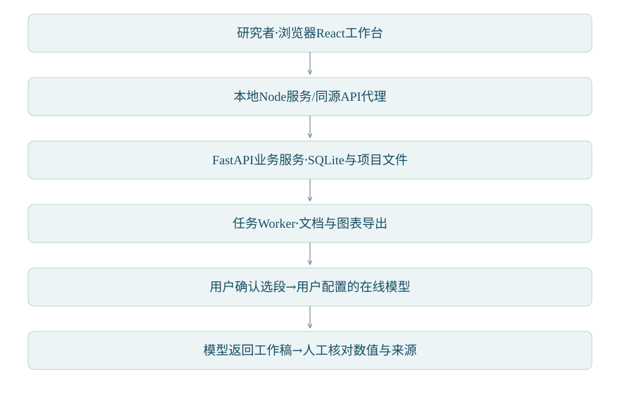
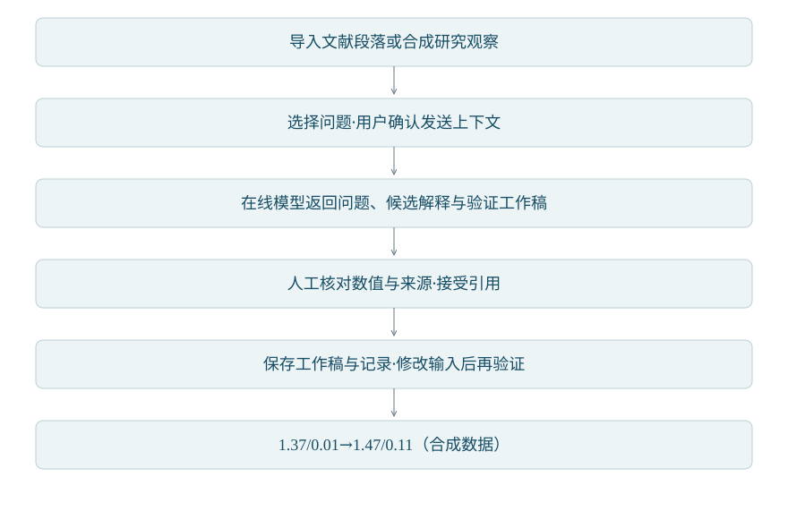

# 系统架构与操作流程
## 1 系统边界
星钥科研智能工作台包含WorkBench与内嵌Paper。浏览器工作台通过本地Node服务及同源API代理访问FastAPI后端；相应记录服务使用SQLite，任务Worker处理持久任务和文档、图表导出。

## 2 数据流与模型边界

关键AI数据流：文献段落或研究观察→用户确认发送→在线模型返回问题、候选解释与下一步验证工作稿→研究者核对数值与来源后保存。模型与本地记录、格式处理及制图是不同能力。

两次真实DeepSeek证据显示，输入从1.37/0.01更新至1.47/0.11后，第二次输出使用更新值；模型使用明确选段数值及数据概要，不证明自行计算全部CSV或自动确证假设。第一条312字超过200字要求，人工复核仍不可省略。

模型是可配置外部能力。未配置时明确提示模型未启用或使用本地模板；在线模型收到用户确认发送的上下文。凭据、真实用户数据库和附件不进入公开附件包。

## 3 操作与证据

导入合成材料后，用户选择研究问题、检查发送内容，调用模型形成工作稿。研究者核对事实，人工确认来源，再保存实验记录或导出成果。

需要分别检查三个结果：程序数据处理是否符合预期；引用接受、取消与重编号是否正确；真实模型是否遵循输入事实与边界。任一环节成功都不能替代其他环节的验收。

演示样例为4组12行合成测量。均值1.00、1.20、1.36、1.37；修改末组三个值各增加0.10后，末组应为1.47。这里没有统计显著性或实际科研有效性主张。

发行包默认持久化数据，--new-data创建新隔离数据而不删除旧数据。仅按本地访问设计；没有已验证远程站点的主张。最终运行和AI验证范围请结合验证摘要阅读。

本次验证覆盖新包双库启动、引用接受与记录重开、真实图表生成，以及同机C盘重定位后两次重启的持久性。两次真实DeepSeek合成请求保留1.37/0.01与1.47/0.11；第一条字数超限需人工复核。尚未进行第二台物理设备测试。

公开源码与固定评审版本见 [仓库首页](../README.md)。源码在本机运行，Windows x64 便携包正在内部验收。
